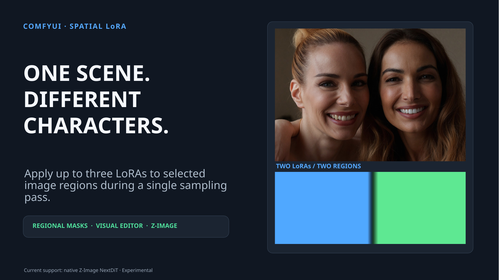
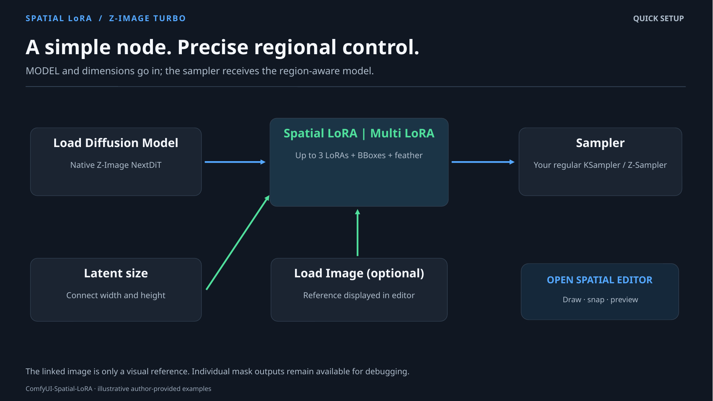
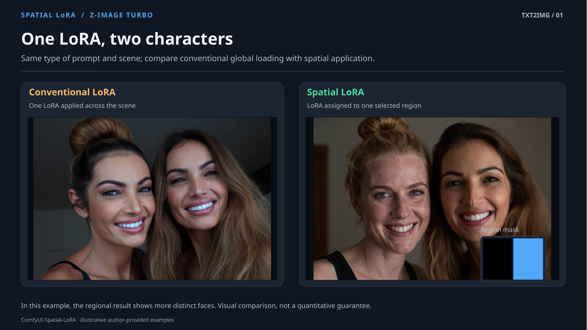
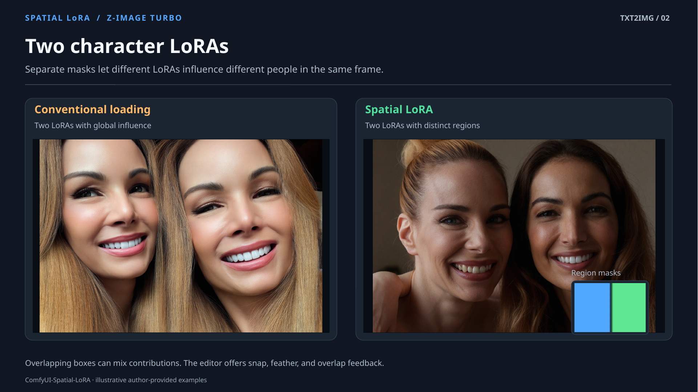
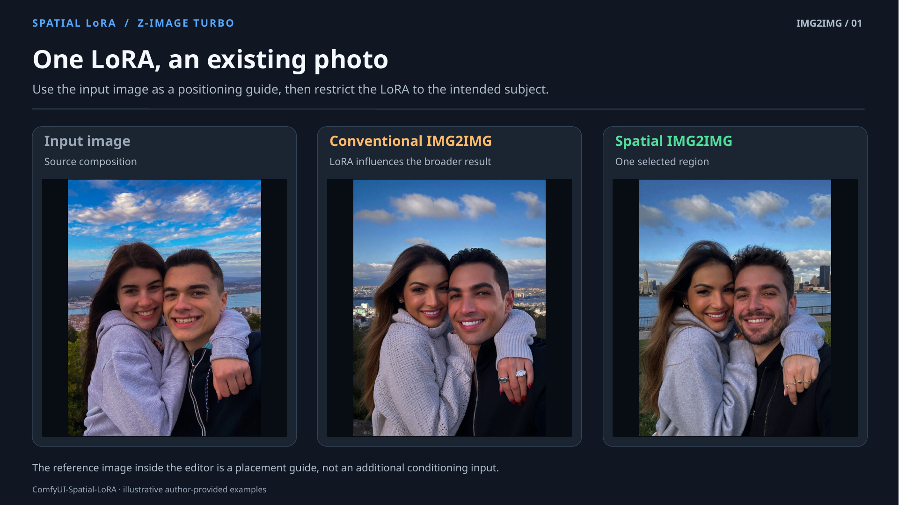
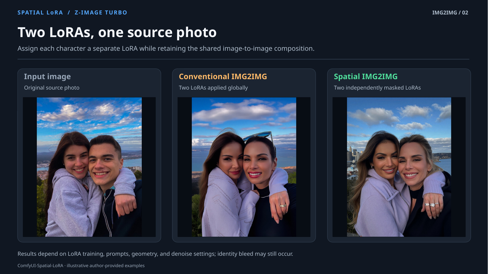
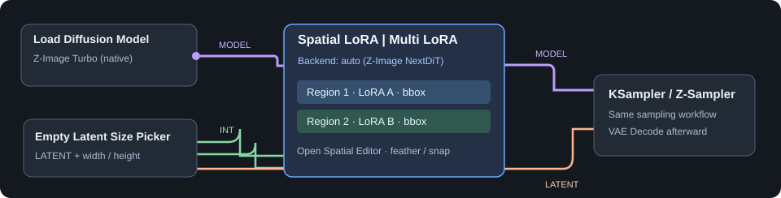

<div align="center">

# ComfyUI Spatial LoRA
**Custom node for multiple LoRAs.**


</div>

Apply **up to three different LoRAs to selected areas of the same image** using one ComfyUI node. Draw bounding boxes, preview feather and overlap, and keep your usual sampler and prompt workflow.

> **Experimental — currently supports native Z-Image Turbo (NextDiT) only.** Spatial masking limits direct LoRA contributions; complete identity isolation is not guaranteed.

## Latest release
### v0.7.1
Added:
- Project initial commit
- Visual editor with drag, resize, snap, feather preview, and overlap warnings
- Optional linked `reference_image` for easier IMG2IMG region placement

Update:
- Unified **Spatial LoRA | Multi LoRA** node with up to three(3) independent regions
- Terminal diagnostics for model backend, regions, coverage, and hook lifecycle

## WIP — The future of the project
The `auto` backend detects a **supported** architecture; it does not automatically make other models compatible. The list below tracks future implementations:
- [x] **Z-Image Turbo** — native NextDiT (`.safetensors`)
- [ ] FLUX
- [ ] FLUX Klein
- [ ] Krea 2
- [ ] MOSS
- [ ] Qwen

Unfortunately, the models I’ve selected are based on the limitations of my own machine (in terms of what I’m able to run), but please feel free to fork the project and add your own compatibility options; I’ll be working on my own regardless.

## Features
- **One node, multiple identities:** select up to three compatible character LoRAs, each with its own strength and region
- **Spatial Editor:** move and resize boxes, enable snap, preview individual masks and feather, and see overlap warnings
- **Reference image:** connect `Load Image` to `reference_image`, or choose a file directly inside the editor
- **Flexible workflows:** supports TXT2IMG and IMG2IMG; outputs `MODEL`, a color preview and three individual masks
- **Useful logs:** `INFO` diagnostics by default, optional `DEBUG` via `SPATIAL_LORA_LOG_LEVEL=DEBUG`

## Requirements
- ComfyUI with a **native Z-Image Turbo NextDiT** diffusion model (not GGUF or Nunchaku; at least for now)
- Compatible `.safetensors` LoRAs. Text-encoder weights are **not** applied by this node
- No extra Python dependencies beyond those already required by the supported ComfyUI installation

**Example Workflows** also contain separate custom nodes (see [workflows/README.md](workflows/README.md)); those are optional and not plugin requirements.

## Installation

### Git
Inside `ComfyUI/custom_nodes/`, clone this repository:

```bash
git clone https://github.com/VictorDmAlves/comfyui-spatial-lora.git
```

### ZIP
1. Download this repository as a ZIP and extract the `ComfyUI-Spatial-LoRA` folder to `ComfyUI/custom_nodes/`
2. Remove older copies of this plugin from `custom_nodes` to prevent duplicate installations
3. Restart ComfyUI and hard-refresh the browser (`Ctrl+F5`)

Find the node under **Spatial LoRA → Multi LoRA**.

## Quick start


1. Connect `Load Diffusion Model` → **Spatial LoRA | Multi LoRA** → your sampler
2. Connect `width` and `height` from the same latent-size node used by the sampler (optional; you can still select values ​​for these) 
3. Select your LoRAs, then click **Open Spatial Editor** to place the regions and set feather/strength
4. For IMG2IMG, optionally connect your `Load Image` to **reference_image** for automatic visual alignment
5. Use `preview` → `Preview Image` to inspect region coverage. Include LoRA trigger words in the prompt when applicable

**Tip:** Non-overlapping regions generally make identity separation easier. Overlap is allowed, and snap can help avoid accidental intersections

## Examples with Z-Image Turbo

### TXT2IMG — One character LoRA


### TXT2IMG — Two character LoRAs


### IMG2IMG — One character LoRA


### IMG2IMG — Two character LoRAs


These are **illustrative examples supplied by me**, not a benchmark. Performance depends on the LoRA training data, prompt, image layout and denoise settings. The masks control direct regional LoRA contributions; attention-based identity bleed can still occur. See my notes in [docs/Examples.md](./docs/Examples.md).

## Workflow overview

Spatial LoRA integrates directly into your existing ComfyUI Workflow, without requiring a separate sampler or additional generation passes.

Connect your diffusion model to the `Spatial LoRA | Multi LoRA node`, then send its MODEL output to your sampler. Link the image dimensions from your latent-size node to keep the spatial regions accurately aligned.

Your existing text encoding, conditioning, and VAE setup remain unchanged. Simply select your LoRAs, open the `Spatial Editor`, and define where each one should be applied.

## Example Workflows
Ready-to-configure JSON files are included in [workflows/](./workflows/):
- [Z-Image Turbo Spatial TXT2IMG](./workflows/)
- [Z-Image Turbo Spatial IMG2IMG](./workflows/)

Load them into ComfyUI and select your **own** model files, LoRAs, and prompt. Both templates intentionally start without a selected LoRA. For the IMG2IMG Workflow, see [workflows/assets/example.png](./workflows/assets/example.png) and the setup note for a quick explanation.

## Node fields
| Field | Purpose |
| --- | --- |
| `model` | Native supported diffusion model |
| `width`, `height` | Final output dimensions (link from latent-size node) |
| `backend` | `auto` or `zimage_nextdit` |
| `lora_1..3`, `strength_1..3` | LoRA and intensity for each numbered region |
| `reference_image` | Optional editor-only visual reference; not image conditioning |
| `preview`, `mask_1..3` | Output previews for inspection/debugging |

## Troubleshooting
- **Unsupported backend:** check that your diffusion model is native Z-Image Turbo NextDiT; `auto` supports only implemented backends
- **Wrong region placement:** confirm that `width` / `height` match the sampling resolution; reopen the editor after changing dimensions
- **LoRA not applied:** assign a LoRA to an enabled region and check its strength and trigger word
- **Identity bleed:** reduce overlap, verify masks, and compare with a fixed seed. Perfect separation is not guaranteed
- **Editor changes not visible:** restart ComfyUI and hard-refresh the browser

## Updating
Run `git pull` inside the plugin folder (if installed with Git), or replace the plugin folder with the newer ZIP. Restart ComfyUI afterwards.

Remember to back-up important Workflows before larger version upgrades.

## Compatibility note
Current support is specific to native Z-Image Turbo **NextDiT** projections. The `auto` option selects only a backend that is already implemented. GGUF, Nunchaku, FLUX, Qwen and other architectures are **not** supported yet.

## Acknowledgements
Built for the ComfyUI ecosystem. The demonstration images and workflows were prepared by me. Model and `custom_node` dependencies in the Workflow examples belong to their respective maintainers.

## License
See [LICENSE](LICENSE).